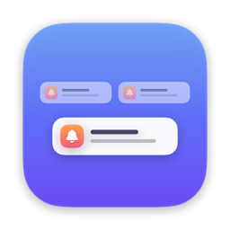
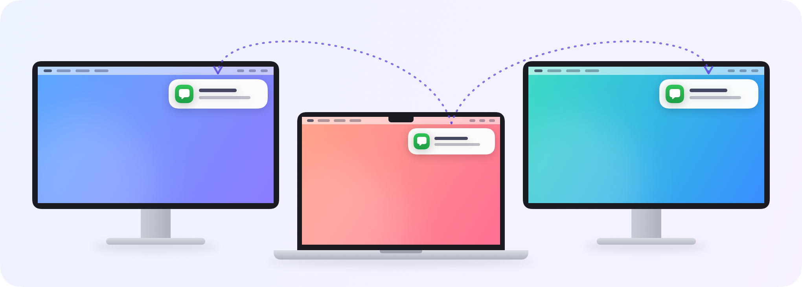

<p align="center">
  
</p>

<h1 align="center">NotiMirror</h1>

<p align="center">
  Mac 알림을 <b>모든</b> 모니터에서 보세요.<br>
  <a href="README.md">English</a> · <b>한국어</b>
</p>

<p align="center">
  
</p>

## 다른 화면 보다가 알림 놓치지 마세요

맥북에 외장 모니터를 연결해서 쓰면, macOS는 알림 배너를 한 화면에만 띄웁니다. 대개 지금 안 보고 있는 맥북 화면이라 Slack 메시지나 카카오톡 답장, 회의 알림을 놓치기 쉬워요.

NotiMirror를 쓰면 배너가 뜨는 순간 나머지 모니터의 우측 상단에도 같은 배너가 함께 뜹니다.

## 특징

- **원본과 똑같이 보입니다.** 실제 배너를 그대로 복사해서, 앱 아이콘, 프로필 사진, 내용까지 원본과 같아요.
- **원본과 함께 뜨고 사라집니다.** 늦게 뜨거나 혼자 남아 있지 않습니다.
- **모든 앱에서 됩니다.** Slack, 카카오톡, 메시지, 메일, 캘린더 등 알림을 보내는 앱이면 다 됩니다.
- **알림 설정을 그대로 따릅니다.** 집중 모드나 앱 설정 때문에 배너가 안 뜨면 NotiMirror도 띄우지 않아요.
- **방해하지 않습니다.** 메뉴바에만 있고 CPU를 거의 쓰지 않으며, 복제본은 클릭을 막지 않습니다.
- **안심하고 쓸 수 있습니다.** 아무것도 저장하거나 외부로 보내지 않습니다.

## 필요한 것

- Apple Silicon Mac
- macOS 26 이상
- Xcode 또는 Xcode Command Line Tools. 아직 바로 받을 수 있는 설치 파일이 없어서 명령어 한 줄로 직접 빌드해야 해요.

## 설치

1. 소스를 받아서 빌드합니다.

   ```bash
   git clone https://github.com/jife-archive/NotiMirror.git
   cd NotiMirror
   ./build.sh --install
   ```

   `swiftc` 관련 오류가 나면 먼저 `xcode-select --install`로 Command Line Tools를 설치하세요.

2. NotiMirror가 열리면서 **화면 기록** 권한을 요청합니다. 시스템 설정 › 개인정보 보호 및 보안 › 화면 및 시스템 오디오 녹음에서 **NotiMirror**를 켜세요.
3. macOS가 물어보면 **종료 및 다시 열기**를 누르세요.
4. 메뉴바에 종 모양 아이콘이 생기면 끝입니다. 다음 알림부터 모든 모니터에 뜹니다.

> **팁:** Xcode에 Apple Development 인증서가 있으면 빌드할 때 자동으로 그 인증서로 서명합니다. 그러면 다시 빌드해도 macOS가 권한을 또 묻지 않아요.

## 사용법

메뉴바의 종 아이콘을 누르면 메뉴가 열립니다.

| 메뉴 | 설명 |
|---|---|
| 일시 정지 | 복제를 잠시 끕니다 |
| 로그인 시 자동 실행 | Mac에 로그인하면 NotiMirror가 자동으로 켜집니다 |
| 테스트 알림 보내기 | 테스트 알림을 보내서 다른 모니터에도 뜨는지 확인합니다 |
| 로그 보기 | 기록 파일을 엽니다. 문제를 알려 주실 때 유용해요 |
| NotiMirror 종료 | 앱을 종료합니다 |

## 자주 묻는 질문

**왜 화면 기록 권한이 필요한가요?**
원본과 똑같은 복사본을 보여 주려면 알림 배너를 봐야 하기 때문이에요. 알림 배너만, 그것도 화면에 떠 있는 동안에만 보고, 아무것도 저장하거나 보내지 않습니다.

**맥북만 쓸 때는 아무 일도 안 일어나요.**
정상이에요. NotiMirror는 *다른* 모니터에 복사본을 띄우는 앱이고, 원본은 이미 맥북에 떠 있으니까요.

**복사본을 클릭할 수 있나요?**
아직은 안 됩니다. 복사본을 클릭하면 그 뒤에 있는 창이 눌려요. 알림을 열려면 원본 배너를 클릭하세요.

**macOS가 화면 기록을 계속 허용할지 또 물어봐요.**
macOS가 화면 기록 앱을 가끔 다시 확인할 수 있어요. 계속 쓰려면 **허용**을 누르세요.

**macOS 업데이트 후에 안 돼요.**
NotiMirror는 macOS가 알림을 띄우는 방식에 기대고 있어서, 버전이 바뀌면 동작이 달라질 수 있어요. 이슈를 열고 로그(메뉴 › 로그 보기)를 첨부해 주세요.

## 삭제

1. 메뉴바에서 **로그인 시 자동 실행**이 켜져 있으면 끄고, **NotiMirror 종료**를 누릅니다.
2. 앱과 데이터를 지웁니다.

   ```bash
   rm -rf ~/Applications/NotiMirror.app
   rm -f ~/Library/Logs/NotiMirror.log
   defaults delete local.notimirror
   ```

3. 시스템 설정 › 개인정보 보호 및 보안 › 화면 및 시스템 오디오 녹음에서 NotiMirror를 제거합니다.

## 상태

NotiMirror는 초기 프로토타입이에요. 지금까지 Apple Silicon Mac의 macOS 27.0.1에서만 테스트했습니다. 의견이나 버그 제보는 언제든 환영해요.

## 라이선스

[MIT](LICENSE)
